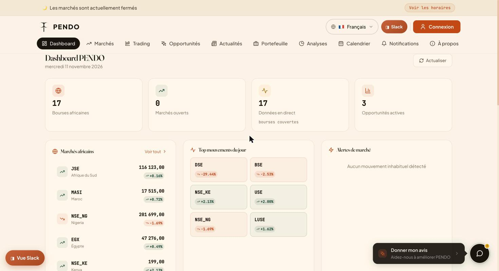

# PENDO — les marchés financiers africains en un seul endroit

> La première plateforme dédiée aux marchés financiers du continent africain.

**Démo en ligne : https://pendo-frontend.vercel.app**



PENDO réunit les cours, l'actualité économique et les opportunités d'investissement de
**17 bourses africaines** (JSE, NGX, EGX, BRVM, NSE Kenya, Casablanca, GSE…), avec l'ambition
d'être un « Bloomberg » pour l'Afrique.

## Fonctionnalités

- **Marchés** — indices et valeurs, graphiques interactifs, horaires d'ouverture par bourse
- **Actualités** — agrégation automatique des news économiques africaines (scraping + RSS)
- **Opportunités** — immobilier, finance, santé, tech, énergie, mines, tourisme, consommation
- **Portefeuille & alertes** — suivi de positions, alertes de prix, notifications
- **Analyses** — indicateurs techniques, screener, détection d'anomalies de marché
- **Communauté** — chat temps réel et forum
- **Trilingue** — français, anglais, arabe (avec affichage de droite à gauche)
- **PWA** — installable sur mobile

## Architecture

```
frontend/   React 18 · Tailwind CSS · Recharts & Lightweight Charts · i18next   → Vercel
backend/    Node.js · Express · PostgreSQL (Supabase) · Cheerio · Socket.io    → Vercel serverless
```

- Le **backend** collecte les données (scrapers, Twelve Data, Yahoo Finance en secours),
  les stocke dans PostgreSQL et les expose en API REST (~30 routes).
- La collecte est **planifiée** (tâches cron) et dédoublonne les actualités.
- La base est protégée par **Row Level Security** : seules les données publiques
  (actualités, opportunités) sont lisibles directement depuis le navigateur.
- Aucun secret dans le code : tout passe par des variables d'environnement
  (voir `backend/.env.example` et `frontend/.env.example`).

## Lancer en local

```bash
# Backend
cd backend
npm install
cp .env.example .env        # DATABASE_URL, JWT_SECRET, TWELVE_DATA_KEY…
npm start                   # http://localhost:3001

# Frontend (autre terminal)
cd frontend
npm install
cp .env.example .env.development   # REACT_APP_API_URL=http://localhost:3001
npm start                          # http://localhost:3000
```

Détails : [`frontend/README.md`](frontend/README.md) et [`backend/README.md`](backend/README.md).

## Statut

Bêta publique, en cours d'audit avant lancement (fraîcheur des données, traductions,
tests fonctionnels).

## Licence

© Modibo Magassa — tous droits réservés. Code visible à titre de consultation uniquement, voir [`LICENSE`](LICENSE).

---

Conçu et développé par **Modibo Magassa** —
[LinkedIn](https://www.linkedin.com/in/modibo-magassa-608a39141/)
